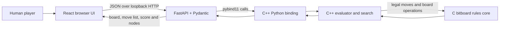

# Professor Presentation Guide

## Project in one sentence

**Bitboard Chess Engine Lab** is a local human-versus-computer chess application whose rules and board representation are implemented in C, whose evaluation and search are implemented in C++, and whose Python API serves a browser interface and reports the engine's search statistics.

## Technology stack

| Layer | Technology | What it does here |
| --- | --- | --- |
| Board/rules core | C99, `uint64_t` bitboards | Stores pieces, generates candidate moves, filters legal moves, parses FEN/UCI, applies moves, and calculates Zobrist keys |
| Evaluation/search | C++17, STL, `std::chrono` | Scores positions, searches candidate lines, observes a time limit, and keeps search telemetry |
| Python integration | pybind11 | Exposes the native `SearchEngine` class and move/state methods to Python as `chess_engine` |
| Local API | Python 3.10+, FastAPI, Pydantic, Uvicorn | Validates requests, owns one game state, runs human and engine moves, and serves the frontend |
| Browser UI | HTML, CSS, React 18, Babel standalone | Displays the board, accepts moves, and presents evaluation, search settings, and move history |
| Optional model experiment | PyTorch | Trains and exports the small evaluator checkpoint; it is not required to play the game |
| Build | setuptools, a C/C++ toolchain | Compiles the C/C++ sources into the Python extension |

There is no JavaScript package build step in this version. React and Babel are loaded from pinned public CDNs, so the browser needs an internet connection even though the engine and API are local.

## Architecture



The browser sends a move request to the Python server. The server checks that it is valid, applies the human move through the native extension, asks the engine to search for a reply, applies that reply, and returns the updated board plus telemetry. The server protects the shared game state with a re-entrant lock because requests can be handled on worker threads.

## What the C core does

### Board representation

The board has twelve piece bitboards: one 64-bit integer for each piece kind and color. Bit `n` represents square `n`; the low three bits encode the file and the next three bits encode the rank. Three extra occupancy masks identify White's pieces, Black's pieces, and all occupied squares. A square lookup scans the twelve piece masks.

This representation makes common operations compact. For example, removing the least-significant set bit visits every piece of one kind without checking all 64 squares:

```c
while (pieces) {
    int square = bit_ctzll(pieces);
    pieces &= pieces - 1;
    /* process the piece on square */
}
```

### Move generation and legality

- Pawn, knight, and king attack masks are precomputed during initialization.
- Rook, bishop, and queen attacks are traced along board rays until the first occupied square.
- Pseudo-legal candidates include captures, double pawn pushes, en passant, castling, and all four promotion choices.
- To produce legal moves, the core applies each candidate to a copied board and rejects it if the moving side's king is attacked afterward. This also catches pinned pieces and en-passant discoveries without separate pin logic.
- Castling checks the king's starting, transit, and destination squares and verifies the rook and right are present.
- The public `make_move` path checks that a requested move exists among generated candidates. The faster `make_generated_move` path is for trusted moves already returned by the generator and is used inside search.

### Input, hashing, and correctness checking

FEN input is bounded and checked for six fields, valid ranks and piece counts, one king per side, pawn placement, castling consistency, en-passant state, clocks, and king safety. UCI input accepts only legal four- or five-character coordinate moves with `q`, `r`, `b`, or `n` promotions.

The core maintains a Zobrist hash from piece-square occupancy, side to move, castling rights, and en-passant square. Search uses that key to look up prior analysis in its transposition table.

`perft` recursively counts legal move paths. It is a standard way to compare a move generator against published reference positions before relying on the search.

## What the C++ engine does

### Position evaluator

The evaluator combines material values with simple piece-square bonuses. It computes both middlegame and endgame scores, then blends them using a material phase value. The evaluator returns centipawns from the side-to-move's perspective, which keeps the negamax search's score sign consistent.

An optional 768 → 128 → 1 network can be loaded from a raw float32 checkpoint. The 768 inputs correspond to twelve piece identities times 64 squares. Its hidden activation is clipped to the range 0–1. The result is blended at 25% with the hand-built score so an experimental checkpoint cannot dominate the established material/PST evaluation. The server does not load a checkpoint automatically; without an explicit load, the engine uses the hand-built evaluator.

The included trainer uses generated synthetic occupancy-like examples and heuristic targets. This demonstrates training and weight export, but it is not training on a corpus of real chess games and should not be presented as a strong learned chess model.

### Search

The engine uses several standard search ideas:

1. **Iterative deepening** searches depth 1, then 2, then 3, up to the requested limit. It keeps the last completed result if the time limit interrupts a later iteration.
2. **Negamax with alpha-beta pruning** searches from the current side's perspective and skips branches that cannot change the decision.
3. **Principal variation search (PVS)** searches the first ordered move with a full window. Later moves get a narrow test window and are searched again only if they improve the current best line.
4. **Move ordering** considers the transposition-table move, captures, promotions, and quiet moves that previously caused a cutoff (killer moves).
5. **Quiescence search** extends leaf positions through captures and promotions, and searches every legal evasion when the side to move is in check. This reduces evaluations made in the middle of an unresolved capture sequence.
6. **Transposition table** stores position keys, scores, searched depth, a best move, and an exact/lower/upper bound. Mate scores are adjusted when stored and restored so their distance remains meaningful at a different search ply.
7. **Time control** checks a monotonic clock every few hundred nodes to limit the overhead of frequent clock reads.

The table is direct-mapped with 1,048,576 entries. The engine also caps direct API requests at 64 plies and 60 seconds; the web API applies tighter limits.

## Python API and browser flow

| Route | Purpose |
| --- | --- |
| `GET /` | Serve the browser interface |
| `GET /state` | Return board, legal moves, status, FEN, history, and telemetry |
| `POST /move` | Apply a legal human move, search, and apply the engine reply |
| `POST /reset` | Reset the game and search telemetry |
| `POST /fen` | Load a validated FEN position |

Pydantic models reject unknown request fields and bound the depth, time, square indices, FEN length, and UCI notation. Responses include basic browser security headers. The server binds to `127.0.0.1` in the documented command and is intended for local demonstration, not public deployment.

The page shows the board, side to move, legal destinations, last move, check, promotion choices, a material-evaluation bar, engine score, completed depth, nodes, nodes per second, best move, and move history. The history is in UCI coordinate notation rather than human algebraic notation.

## Demo plan

1. Start the server with the command in `README.md`, then open `http://127.0.0.1:8000`.
2. Point out the stack path: C rules core → C++ evaluation/search → pybind11 → Python API → browser.
3. Play `e2` to `e4` and watch the engine reply. Mention that it searches for Black after the human move.
4. Show the completed depth, nodes, nodes/second, and score. Explain that increasing the time or depth gives the engine more opportunity to search.
5. Use **New game** and, if useful, show the move history and promotion dialog.
6. Explain that perft counts legal paths and is a correctness check, not a measure of playing strength.

For a smooth demo, start the server before presenting and verify the Python extension builds on the presentation machine. The server should stay open in its terminal. The frontend's CDN dependencies mean an internet connection is needed for React and Babel.

## Checks run during this review

- Start position perft: depth 1–4 matched `20`, `400`, `8,902`, and `197,281`.
- Kiwipete perft: depth 1–3 matched `48`, `2,039`, and `97,862`.
- Additional native checks exercised strict FEN parsing, halfmove/fullmove clocks, a legal en-passant capture, an en-passant move that exposes the king and must be rejected, knight promotion, rejection of an invalid promotion suffix, an illegal fabricated move leaving the board unchanged, checkmate, stalemate, a 50-move draw, and a legal search result.
- C and C++ compiled with Zig's Clang frontend using C99/C++17 and `-Wall -Wextra -Wpedantic` without warnings. The pybind11 extension also compiled and imported.
- A local HTTP/browser smoke check loaded the page, returned 20 opening legal moves, played `e2e4` and got `b8c6`, rejected a malformed FEN with HTTP 422, and reset the game.

## Honest limitations to mention

- This is an educational engine, not a grandmaster-strength or tournament-tested engine.
- Repetition detection is not implemented, so the engine does not recognize threefold repetition in search or game status.
- The game-status layer handles checkmate, stalemate, and a simplified 50-move draw, but does not implement every FIDE draw rule such as insufficient material or the 75-move rule.
- Move history is UCI notation, not SAN, and the frontend currently plays White against the engine as Black.
- The optional training examples are synthetic; the network is experimental and is not loaded by the web service automatically.
- The browser uses pinned CDN scripts, so the current page is not an offline bundle.

## Short oral explanation

> I separated the project into a rules layer and a decision layer. The C layer stores each piece type as a 64-bit bitboard, generates moves, and filters out moves that leave the king in check. The C++ layer scores a position and searches with iterative-deepening negamax, alpha-beta pruning, move ordering, a transposition table, and quiescence search. Pybind11 connects the native engine to a Python FastAPI service, and the browser sends moves to that local service. I validated the move generator with standard perft counts, including Kiwipete, and added input checks around FEN, UCI moves, API request ranges, and model files. The current target is a clear educational demonstration; repetition draws and some other tournament rules are still outside its scope.

## Questions you may be asked

**Why use bitboards?** A 64-bit integer maps directly to 64 squares, so membership, occupancy, and many attacks are cheap bit operations. Separate masks also make piece enumeration compact.

**How do you know a generated move is legal?** Generate a candidate, apply it to a board copy, then test whether the moving side's king is attacked. Special castling and en-passant constraints are checked as part of candidate validation/application.

**What does alpha-beta pruning change?** It keeps the minimax/negamax result but stops exploring branches once their score is already worse than a known alternative.

**Why use quiescence search?** A static score at a leaf can be misleading during a capture sequence. Quiescence searches tactical continuations until the position is quieter, with all evasions searched if the king is in check.

**What does the evaluation score mean?** It is centipawns from the side-to-move's perspective: about `+1.00` means an estimated one-pawn advantage for that side. The browser converts it to White's perspective for display.

**How did you check the move generator?** Perft counts all legal move paths to a fixed depth and compares the counts with trusted reference values. A mismatch can point to a rules bug before engine strength is considered.

**Does the neural network make it a neural chess engine?** Not by itself. The current model is small and trained on synthetic examples. The primary, dependable evaluation is handcrafted material and piece-square scoring; the network is an optional experiment blended conservatively.
